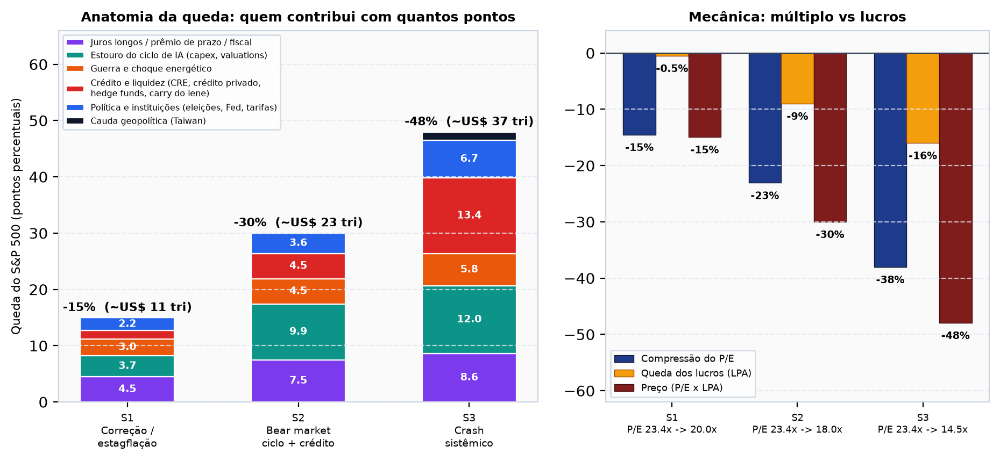
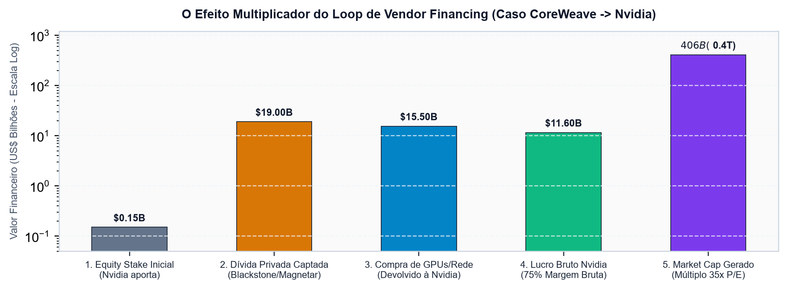
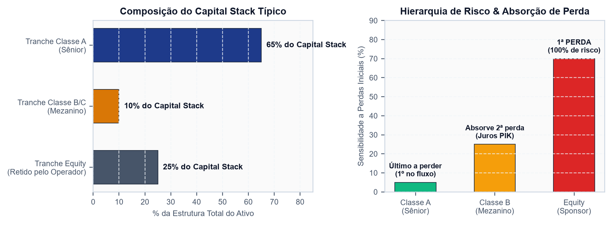
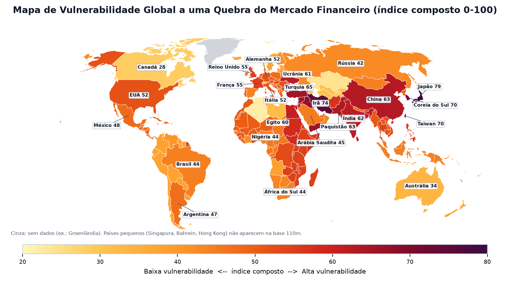

# AI Infrastructure & Credit Bubble: Systemic Risk Assessment (2026–2029)
> **Institutional Forensic Dossiers, Synthetic ABS Structuring, Vendor Financing Circularity & Macro-Geopolitical Contagion Analysis**

<p align="center">
  <a href="#-english-version"><b>English Version</b></a> •
  <a href="#-versão-em-português"><b>Versão em Português</b></a>
</p>

---

<p align="center">
  
  
  
  
</p>

---

# 🇺🇸 English Version

## 1. Executive Summary

This repository hosts an institutional forensic investigation into the systemic credit architecture, capital recycling loops, and macro-geopolitical transmission channels underpinning the current **Artificial Intelligence infrastructure supercycle**.

Between 2023 and 2026, over **$350 billion** in capital expenditure (CapEx) was funneled into artificial intelligence compute clusters, data centers, and advanced silicon. However, an increasing share of this expansion has decoupled from end-user enterprise software revenues. Instead, it relies on:
1. **Vendor Financing Circularity**: Chip designers taking equity stakes in neocloud operators and AI labs who are contractually bound to purchase chips from the same vendor.
2. **GPU-Backed Debt & Hyper-Depreciation**: High-yield and private credit facilities collateralized by silicon assets (NVIDIA H100/B200) whose technical obsolescence (2.5–3 years) outpaces debt maturity schedules (5–7 years).
3. **Data Center ABS & Synthetic Repackaging**: Securitizing long-term data center leases through SPVs (Special Purpose Vehicles) into senior investment-grade tranches (rated AAA/A by rating agencies such as KBRA) and subordinated high-yield tranches, reminiscent of the 2007–2008 subprime mortgage repackaging engine.
4. **Macro-Geopolitical Vulnerability & Fiscal Cliff**: The intersection of rising US sovereign debt servicing ($36.5T debt, >$1.1T annual interest), election cycle regulatory shifts, Middle Eastern sovereign wealth fund reallocations, and semiconductor supply chain choke points in the Taiwan Strait.

<p align="center">
  
  <br>
  <em>Figure 1: Anatomy and transmission channels of the projected market crash (2026–2028).</em>
</p>

---

## 2. Core Forensic Pillars

```
+-----------------------------------------------------------------------------------+
|                        THE AI CAPITAL RECYCLING MACHINE                           |
+-----------------------------------------------------------------------------------+
|   [Mega-Cap Tech / Chip Designers]                                                |
|             |                                                                     |
|             v (Equity Investments & Convertible Debt)                             |
|   [Neocloud Operators & Frontier Labs (CoreWeave, Lambda Labs, OpenAI, Anthropic)] |
|             |                                                                     |
|             v (Debt-Funded GPU Purchases: H100 / Blackwell B200)                  |
|   [SPVs & Collateralized Hardware Pools] <----+ (Private Credit: Blackstone,      |
|             |                                 |  Blue Owl, Magnetar, Carlyle)     |
|             v (Lease Revenues & Off-Balance PPA)                                  |
|   [Data Center ABS Vehicles (KBRA Rated A / BBB)]                                 |
|             |                                                                     |
|             v (Tranche Distribution to Institutional Pension Funds & Fixed Income)|
|   [Institutional Capital Markets (AAA Senior Notes)]                              |
+-----------------------------------------------------------------------------------+
```

### Pillar A: Vendor Financing & Revenue Loops
- **Mechanism**: Major semiconductor manufacturers invest capital into private startups and cloud providers. The recipients immediately re-route these funds back to the vendor in the form of guaranteed GPU purchase orders.
- **Systemic Risk**: Upwards of 20% to 35% of reported hardware revenue across key suppliers reflects balance-sheet recycling rather than organic corporate end-user demand.

<p align="center">
  
  <br>
  <em>Figure 2: The closed-loop vendor financing dynamic between hardware providers, neoclouds, and hyper-scalers.</em>
</p>

### Pillar B: GPU Collateral Mismatch & Collateral Run
- **Useful Economic Life vs. Amortization**: Enterprise GPUs suffer drastic economic depreciation upon the release of subsequent architectures (e.g., Hopper H100 pricing compression following Blackwell B200 deployment).
- **Negative Equity Dynamic**: Loans structured with 70–80% Loan-to-Value (LTV) ratios on hardware enter technical default when secondary market GPU rental prices drop below $1.50/GPU-hour, breaching debt service coverage covenants ($DSCR < 1.10x$).

<p align="center">
  
  <br>
  <em>Figure 3: Divergence between physical/economic GPU depreciation curves and amortizing debt schedules.</em>
</p>

### Pillar C: Data Center ABS & The "Subprime AI" Alchemy
- **Securitization Structure**: Powered shell and turnkey data centers are segregated into bankruptcy-remote SPVs. Cash flows from Master Service Agreements (MSAs) and triple-net leases back multi-tranche Asset-Backed Securities (ABS).
- **Subprime Parallel**: Similar to pre-2008 residential mortgage-backed securities (RMBS), correlation risks between unrated tech counterparties and high concentration risks (>60% of revenues tied to single unrated AI startups) are diluted through credit enhancement to achieve investment-grade ratings for senior debt.

<p align="center">
  
  <br>
  <em>Figure 4: Data Center ABS Capital Structure (Senior Class A Notes, Subordinated Class B, and Residual Equity).</em>
</p>

### Pillar D: Global Macro & Geopolitical Transmission
- **Fiscal Pressures**: Rising US Treasury yields and sovereign debt refinancing friction increase the cost of capital for CapEx-intensive tech infrastructure.
- **Geopolitical Bottlenecks**: High geographic concentration in advanced packaging (TSMC CoWoS, Taiwan) creates severe tail-risk vulnerabilities to supply interruptions.

<p align="center">
  
  <br>
  <em>Figure 5: Systemic Vulnerability Index across global financial and technological epicenters (2026–2028).</em>
</p>

---

## 3. Crash Scenarios (2026–2029) & Probability Buildup

Our multi-factor stress models project cumulative systemic stress across three primary scenarios:

| Scenario | Horizon | Cumulative Probability | Catalyst | S&P 500 / Tech Impact | Credit Market Impact |
|:---|:---:|:---:|:---|:---:|:---|
| **Base Case: Orderly Deflation** | 2026–2027 | **35%** | CapEx growth decelerates to ~10%; enterprise ROI delays; multiple compression. | S&P -15% to -20%<br>Nasdaq -25% | Spreads widen +150 bps; minimal senior ABS impairments. |
| **Severe Case: Credit Dislocation** | 2027–2028 | **45%** | Neocloud default wave; GPU secondary resale collapse; private credit liquidity freeze. | S&P -30% to -40%<br>Nasdaq -45% | High-yield spreads >750 bps; junior ABS wipeout; banking write-downs. |
| **Systemic Case: Multi-Contagion** | 2027–2029 | **20%** | Geopolitical supply shock (Taiwan Strait) + US sovereign debt auction friction + AI revenue cliff. | S&P -50% to -60%<br>Nasdaq -65% | Global liquidity freeze; sovereign yield spike; emergency Fed interventions. |

<p align="center">
  
  <br>
  <em>Figure 6: The AI Credit Leverage Pyramid — From physical silicon assets to synthetic credit derivatives.</em>
</p>

---

## 4. Deliverables Index: Reports & Dossiers

All executive reports are available in full institutional-grade PDF format (35 pages compiled) and detailed technical Markdown dossiers:

### 📑 Executive PDF Reports (Institutional Format)

| Document Title | Language | Pages | Download / Access | Core Focus |
|:---|:---:|:---:|:---:|:---|
| **Macro Geopolitical Market Crash (2026–2028)** | 🇺🇸 English | 10 | [Download PDF](Relatorio_Macro_Geopolitica_Quebra_Mercado_2026_2028_EN.pdf) | US fiscal cliff, election dynamics, geopolitical war-gaming & world vulnerability map. |
| **Macro Geopolítica Quebra de Mercado (2026–2028)** | 🇧🇷 Português | 10 | [Download PDF](Relatorio_Macro_Geopolitica_Quebra_Mercado_2026_2028.pdf) | Versão integral em português do dossiê geopolítico e mapa global de contágio. |
| **US Financial Market & AI Bubble Architecture** | 🇺🇸 English | 8 | [Download PDF](Relatorio_Mercado_Financeiro_Americano_EN.pdf) | Valuation vs 10Y Treasury, private credit build-up & software revenue monetization gap. |
| **Mercado Financeiro Americano e Bolha de IA** | 🇧🇷 Português | 8 | [Download PDF](Relatorio_Mercado_Financeiro_Americano.pdf) | Análise abrangente dos mercados de capitais norte-americanos e risco de bolha. |
| **AI Infrastructure Crash Scenarios (2026–2029)** | 🇺🇸 English | 5 | [Download PDF](Relatorio_Cenarios_Quebra_Mercado_IA_2026_2029_EN.pdf) | Multi-year stress tests, probability buildup, liquidation triggers & contagion sequence. |
| **Cenários de Quebra do Mercado de IA (2026–2029)** | 🇧🇷 Português | 5 | [Download PDF](Relatorio_Cenarios_Quebra_Mercado_IA_2026_2029.pdf) | Modelagem de liquidação forçada, gatilhos de inadimplência e contração de liquidez. |
| **Data Center ABS Official Tranches & KBRA** | 🇺🇸 English | 4 | [Download PDF](Relatorio_Data_Center_ABS_Tranches_Oficiais_EN.pdf) | Securitization mechanics, KBRA rating criteria, LTV thresholds & tranche waterfalls. |
| **Data Center ABS Tranches Oficiais e KBRA** | 🇧🇷 Português | 4 | [Download PDF](Relatorio_Data_Center_ABS_Tranches_Oficiais.pdf) | Estruturação de recebíveis de data centers e critérios de agências de rating. |
| **Forensic AI Subprime & AAA Repackaging** | 🇺🇸 English | 4 | [Download PDF](Relatorio_Forense_Subprime_IA_Repacotamento_AAA_EN.pdf) | 2008 MBS vs 2026 AI ABS analogies, credit enhancement alchemy & counterparty risk. |
| **Dossiê Forense Subprime de IA e Repacotamento AAA**| 🇧🇷 Português | 4 | [Download PDF](Relatorio_Forense_Subprime_IA_Repacotamento_AAA.pdf) | Alquimia de reempacotamento de notas seniores e analogia forense à crise de 2008. |
| **Leverage Multiplier & Vendor Financing** | 🇺🇸 English | 4 | [Download PDF](Relatorio_Alavancagem_e_Vendor_Financing_IA_EN.pdf) | Neocloud circular debt, GPU debt service coverage ratios & vendor financing loops. |
| **Alavancagem e Vendor Financing de IA** | 🇧🇷 Português | 4 | [Download PDF](Relatorio_Alavancagem_e_Vendor_Financing_IA.pdf) | Multiplicador de crédito, balanço patrimonial de neoclouds e circularidade de capital. |

---

### 📂 Technical Markdown Dossiers

| Technical Dossier (English) | Dossier Técnico (Português) | Primary Research Subject |
|:---|:---|:---|
| [Macro Geopolitics & Market Crash Dossier](Dossie_Macro_Geopolitica_Quebra_Mercado_2026_2028_EN.md) | [Dossiê Macro Geopolítica e Quebra de Mercado](Dossie_Macro_Geopolitica_Quebra_Mercado_2026_2028.md) | US fiscal debt, Taiwan Strait, oil choke points & regional ranking. |
| [AI Market Crash Scenarios (2026–2029)](Dossie_Cenarios_Quebra_Mercado_Acoes_e_Credito_EN.md) | [Dossiê Cenários de Quebra de Mercado](Dossie_Cenarios_Quebra_Mercado_Acoes_e_Credito.md) | Multi-year cascade simulation, loss severity and recovery rates. |
| [Data Center ABS Structuring Report](Data_Center_ABS_Relatorio_EN.md) | [Relatório Data Center ABS](Data_Center_ABS_Relatorio.md) | Master Service Agreements, PPA contracts and SPV waterfalls. |
| [Forensic Subprime AI & AAA Alchemy](Dossie_Forense_Subprime_IA_Repacotamento_AAA_EN.md) | [Dossiê Forense Subprime IA Repacotamento](Dossie_Forense_Subprime_IA_Repacotamento_AAA.md) | Synthetic securitization, rating arbitrage, CDO parallels. |
| [AI Credit Leverage & Vendor Financing](Dossie_Alavancagem_Vendor_Financing_IA_EN.md) | [Dossiê Alavancagem e Vendor Financing](Dossie_Alavancagem_Vendor_Financing_IA.md) | Circularity loops between chipmakers, hyper-scalers and neoclouds. |
| [CoreWeave GPU Debt & Financing Analysis](CoreWeave_GPU_Debt_and_Vendor_Financing_Analysis_EN.md) | [Análise da Dívida GPU CoreWeave](CoreWeave_GPU_Debt_and_Vendor_Financing_Analysis.md) | Balance-sheet forensic audit, GPU depreciation vs debt covenants. |
| [KBRA Data Center ABS Rating Methodology](KBRA_Data_Center_ABS_Rating_Methodology_Dossier_EN.md) | [Metodologia de Rating KBRA Data Center](KBRA_Data_Center_ABS_Rating_Methodology_Dossier.md) | Formal credit rating agency methodologies and liquidity reserves. |

---

## 5. Technical Reproduction & Execution

All reports and visual analytical models are programmatically generated using Python and ReportLab:

### Prerequisites & Dependencies
```bash
# Clone the repository
git clone https://github.com/xToshiro/ai-market-crash-risk.git
cd ai-market-crash-risk

# Install required numerical, charting, GIS and PDF engines
pip install reportlab matplotlib numpy pandas geopandas shapely pymupdf
```

### Reproducing Executive PDF Reports
```bash
# Generate English PDF Reports
python generate_macro_geopolitical_crash_report_en.py
python generate_us_market_report_en.py
python generate_market_crash_scenarios_report_en.py
python generate_data_center_abs_tranches_report_en.py
python generate_forensic_ai_subprime_report_en.py
python generate_leverage_multiplier_report_en.py

# Generate Portuguese PDF Reports
python generate_macro_geopolitical_crash_report.py
python generate_us_market_report.py
python generate_market_crash_scenarios_report.py
python generate_data_center_abs_tranches_report.py
python generate_forensic_ai_subprime_report.py
python generate_leverage_multiplier_report.py
```

---
---

# 🇧🇷 Versão em Português

## 1. Visão Geral Executiva

Este repositório reúne uma profunda investigação forense institucional sobre a estrutura de crédito, alavancagem sintética e canais de transmissão macro-geopolítica que sustentam o atual **superciclo de infraestrutura em Inteligência Artificial**.

Entre 2023 e 2026, mais de **US$ 350 bilhões** em despesas de capital (CapEx) foram alocados em infraestrutura de computação acelerada, data centers e chips avançados. Contudo, uma parcela crescente dessa expansão não se traduz em receita recorrente de software no cliente final corporativo, dependendo criticamente de:
1. **Vendor Financing Circular**: Fabricantes de silício injetando capital societário em operadoras de nuvem e startups de IA que, por contrato, reorientam esse caixa para comprar GPUs do próprio fornecedor.
2. **Dívida Lastreada em GPUs e Hiper-Depreciação**: Linhas de crédito privado e mezanino garantidas por ativos de silício (NVIDIA H100/B200) cuja obsolescência técnica (2,5 a 3 anos) é muito mais veloz que o prazo de amortização do passivo (5 a 7 anos).
3. **Data Center ABS e Repacotamento Sintético**: Securitização de contratos de locação de data centers via SPEs (Sociedades de Propósito Específico), fatiadas em tranches seniores com rating AAA/A (por agências como a KBRA) e tranches subordinadas, reproduzindo a mesma dinâmica de incentivos perversos dos subprime RMBS de 2007–2008.
4. **Vulnerabilidade Geopolítica e Abismo Fiscal dos EUA**: A convergência entre o endividamento do Tesouro americano (US$ 36,5 trilhões de dívida soberana, >US$ 1,1 trilhão ao ano em juros), a rotação regulatória do ciclo eleitoral, a repatriação de fundos soberanos do Golfo Pérsico e os gargalos logísticos no Estreito de Taiwan.

---

## 2. Pilares Forenses da Investigação

### Pilar 1: O Loop de Financiamento de Vendedores (Vendor Financing)
Fabricantes líderes de tecnologia fornecem capital de investimento a startups de nuvem especializada (*neoclouds*) e laboratórios de IA. Os recursos recebidos são obrigatoriamente revertidos em aquisições de chips de ponta do próprio investidor. Essa circularidade infla artificialmente o faturamento de curto prazo e adia a descoberta de demanda real do mercado.

### Pilar 2: Descasamento de Depreciação de Hardware e Dívida
Uma GPU de data center tem vida útil econômica de ponta restrita a 2 ou 3 anos antes do lançamento de clusters mais eficientes. Quando operadoras contraem dívida de 5 a 7 anos para amortizar esse equipamento, o valor de revenda e o preço de aluguel por hora caem abruptamente, quebrando o índice de cobertura de serviço da dívida ($ICSD < 1,10x$) e forçando liquidações de garantias.

### Pilar 3: O "Subprime de IA" e o Repacotamento AAA
Data centers são empacotados em estruturas de securitização (Data Center ABS). Por meio de reforços de crédito estruturais (*credit enhancement*), operadoras transformam fluxos de recebíveis dependentes de startups de IA deficitárias em títulos seniores de investimento comercializados a fundos de pensão institucionais.

### Pilar 4: Transmissão Geopolítica e Risco Soberano
O custo do capital global subiu estruturalmente. Com as taxas de juros americanas elevadas e emissões recordes do Tesouro dos EUA, a absorção de centenas de bilhões de dólares em crédito privado para data centers disputa liquidez diretamente com títulos soberanos e fundos imobiliários tradicionais.

---

## 3. Matriz de Cenários de Quebra (2026–2029)

| Cenário | Janela | Probabilidade Acumulada | Gatilho Primário | Impacto no Mercado de Ações | Mercado de Crédito Privado |
|:---|:---:|:---:|:---|:---:|:---|
| **Base: Desinflação Ordenada** | 2026–2027 | **35%** | Crescimento do CapEx desacelera; maturação e corte de múltiplos de avaliação. | S&P 500: -15% a -20%<br>Nasdaq: -25% | Spreads abrem +150 bps; perdas absorvidas pelas tranches de equity. |
| **Severo: Deslocamento de Crédito** | 2027–2028 | **45%** | Onda de inadimplência em neoclouds; derrocada no mercado secundário de GPUs. | S&P 500: -30% a -40%<br>Nasdaq: -45% | Spreads de High Yield >750 bps; colapso de tranches subordinadas de ABS. |
| **Sistêmico: Multi-Contágio Global** | 2027–2029 | **20%** | Choque logístico em semicondutores (Taiwan) + crise de liquidez na dívida soberana dos EUA. | S&P 500: -50% a -60%<br>Nasdaq: -65% | Congelamento de liquidez bancária; intervenção emergencial do Federal Reserve. |

---

## 4. Estrutura do Repositório e Artefatos

Todos os 6 relatórios em formato PDF executivo e os 7 dossiês investigativos em Markdown contam com versões completas em inglês e português:

- **6 Relatórios PDF Executivos em Inglês**: [Pasta de Relatórios EN](Relatorio_Macro_Geopolitica_Quebra_Mercado_2026_2028_EN.pdf) (10, 8, 5, 4, 4 e 4 páginas).
- **6 Relatórios PDF Executivos em Português**: [Pasta de Relatórios PT](Relatorio_Macro_Geopolitica_Quebra_Mercado_2026_2028.pdf) (10, 8, 5, 4, 4 e 4 páginas).
- **7 Dossiês Técnicos em Markdown**: Cobrindo desde as tranches oficiais KBRA até a auditoria forense do balanço patrimonial de neoclouds e cenários de estresse.
- **Base de Gráficos e Mapas**: Mais de 30 visualizações estatísticas em alta definição geradas com Matplotlib e GeoPandas.

---

## 5. Licença e Aviso Legal (Disclaimer)

**Licença**: Este projeto é disponibilizado sob a licença **GNU General Public License v3.0 (GPL-3.0)**. Consulte o arquivo [LICENSE](LICENSE) para termos integrais.

**Aviso Legal / Financial Disclaimer**:
*Este repositório destina-se exclusivamente a fins de pesquisa acadêmica, forense e de inteligência de mercado financeiro. Os modelos, projeções, probabilidades e cenários de estresse aqui apresentados representam simulações analíticas de risco de cauda e não configuram recomendação de investimento, aconselhamento financeiro, solicitação de compra/venda de ativos ou garantia de desempenho futuro.*
