# AI Infrastructure & Credit Bubble: Systemic Risk Assessment (2026–2029)
> **Institutional Forensic Dossiers, Synthetic ABS Structuring, Vendor Financing Circularity & Macro-Geopolitical Contagion Analysis**

<p align="center">
  <a href="#-english-version"><b>English Version</b></a> •
  <a href="#2-special-intelligence-update-october-2026-key-discoveries-vs-baseline-assumptions"><b>October 2026 Discoveries</b></a> •
  <a href="#-versão-em-português"><b>Versão em Português</b></a> •
  <a href="#2-boletim-especial-de-inteligência-outubro-de-2026-novas-descobertas-vs-situação-antiga"><b>Descobertas de Hoje</b></a> •
  <a href="#5-pipeline-automatizado-de-dados-e-atualização-futura"><b>Pipeline de Dados</b></a>
</p>

---

<p align="center">
  
  
  
  
  
  
</p>

---

# 🇺🇸 English Version

## 1. Executive Summary

This repository hosts an institutional forensic investigation into the systemic credit architecture, capital recycling loops, and macro-geopolitical transmission channels underpinning the current **Artificial Intelligence infrastructure supercycle**.

Between 2023 and 2026, over **$350 billion** in capital expenditure (CapEx) was funneled into artificial intelligence compute clusters, data centers, and advanced silicon. However, an increasing share of this expansion has decoupled from end-user enterprise software revenues. Instead, it relies on:
1. **Vendor Financing Circularity**: Chip designers taking equity stakes in neocloud operators and AI labs who are contractually bound to purchase chips from the same vendor.
2. **GPU-Backed Debt & Hyper-Depreciation**: High-yield and private credit facilities collateralized by silicon assets (NVIDIA H100/B200) whose technical obsolescence (2.5–3 years) outpaces debt maturity schedules (5–7 years).
3. **Data Center ABS & Synthetic Repackaging**: Securitizing long-term data center leases through SPVs (Special Purpose Vehicles) into senior investment-grade tranches (rated AAA/A by rating agencies such as KBRA) and subordinated high-yield tranches, reminiscent of the 2007–2008 subprime mortgage repackaging engine.
4. **Macro-Geopolitical Vulnerability & Fiscal Cliff**: The intersection of rising US sovereign debt servicing ($36.5T debt, >$1.1T annual interest), election cycle regulatory shifts, Middle Eastern sovereign wealth fund reallocations, and semiconductor supply chain choke points in the Taiwan Strait.

<p align="center">
  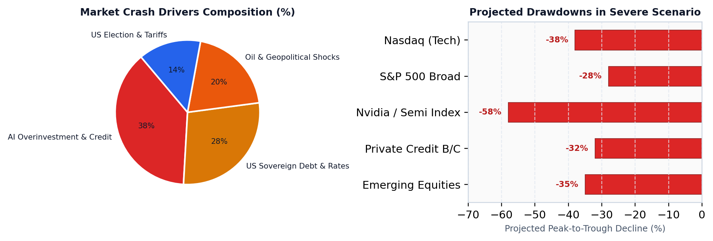
  <br>
  <em>Figure 1: Anatomy and transmission channels of the projected market crash (2026–2028).</em>
</p>

---

## 2. Special Intelligence Update (October 2026): Key Discoveries vs. Baseline Assumptions

The October 2026 intelligence update incorporates critical developments in physical utility grid interconnection, private market tech valuations, hyperscaler capital expenditure velocity, and shadow credit structuring. Below is the forensic comparison between the earlier baseline assumptions and today's reality:

### 📊 Comparative Matrix: Baseline Assumptions vs. October 2026 Ground Truth

| Core Investigation Pillar | Baseline / Past Assumptions | Today's Ground Truth (October 2026) | Systemic Impact & Transmission Channel |
|:---|:---|:---|:---|
| **Power Grid & Data Center Delivery** | Projected unconstrained utility expansion; data centers assumed to energize within 18–24 months globally. | **The Physical Grid Wall**: Landmark cancellation of the **Microsoft–Nscale Essex data center deal** due to transmission incapacity. PJM and National Grid UK interconnection queues are frozen for **7 to 10 years (2033–2036)**. | Acquired land and ordered GPUs risk becoming **"stranded assets"**; non-operational facilities generate zero revenue while debt interest accumulates. |
| **Frontier AI Lab Valuations** | Exponential ARR scaling (>300% YoY); private secondary markets pricing frontier labs (OpenAI, Anthropic) near **$1.5 Trillion** pre-IPO. | **Valuation Haircut & Deceleration**: Anthropic private valuation marked down by **~60% to $600B–$700B**; annual growth decelerated to **~85% YoY** amid enterprise inference cost pressure and open-weight model commoditization. | Impairs equity collateral value; stalls pre-IPO liquidity timelines; triggers multiple compression across public AI software peers. |
| **Hyperscaler CapEx & Credit Leverage** | Annual CapEx assumed to plateau at ~$350B–$400B, fully funded by organic free cash flow from core advertising and enterprise software. | **$700B Hyper-CapEx & Shadow Debt**: Annual CapEx pace reached **$700 Billion run-rate**, increasingly funded via **off-balance-sheet SPVs and private credit** (Blackstone, Ares, Apollo) rather than cash flow alone. | Shifts credit risk into shadow banking; Debt Service Coverage Ratios (DSCR) breach default covenants ($<1.10x$) if tenant deployments lag. |
| **Macro Interest Rates & Refinancing** | Projected rapid Federal Reserve rate cuts down to ~3.0%; benign debt rollover for tech issuers. | **Higher-for-Longer & $36.85T Debt**: US 10-Year Treasury yield holding firmly at **5.10%**; US national debt interest outlays surpass **$1.16 Trillion/year**; corporate debt refinancing costs remain elevated. | Widens high-yield credit spreads (`HYG/LQD` ratio compressed to 0.7433); raises hurdle rates for long-duration infrastructure investments. |
| **Cumulative Crash Probabilities** | Soft-landing / Benign continuation estimated at **70%**; Systemic contagion treated as remote tail-risk (**<15%**). | **Recalibrated Risk Matrix (2026–2029)**:<br>• **Orderly Deflation (S1)**: **40%**<br>• **Credit Dislocation (S2)**: **45%**<br>• **Systemic Contagion (S3)**: **30%**<br>• *Benign Continuation*: Reduced to **25%**. | Subprime AI mechanics transition from theoretical vulnerability to empirical distress triggers. |

<p align="center">
  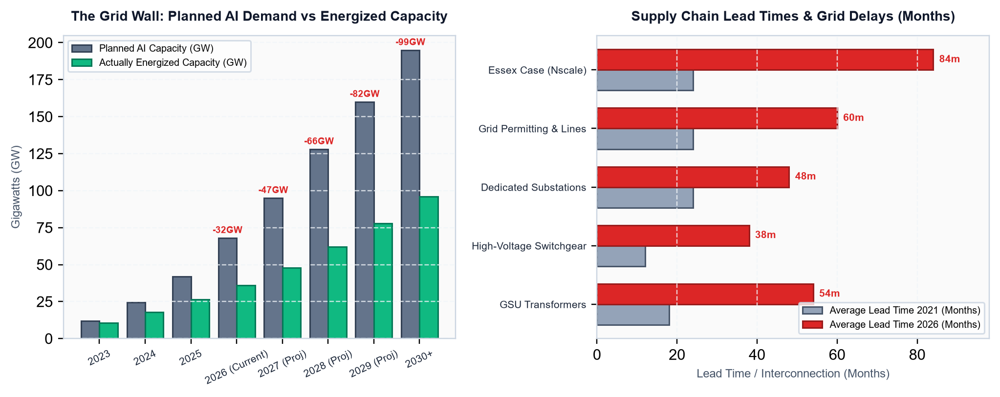
  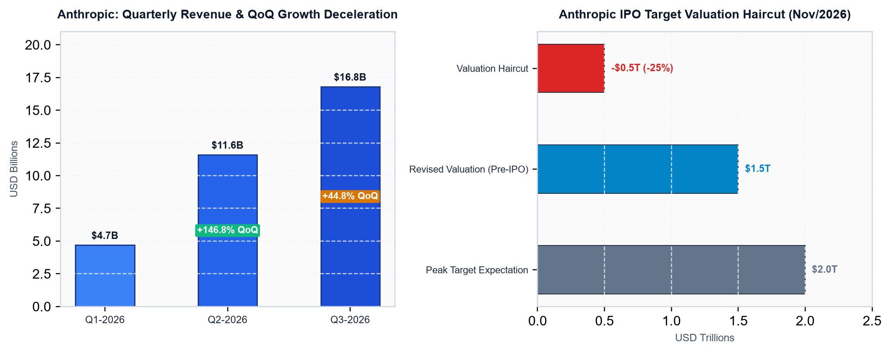
  <br>
  <em>Figure 2: Physical power transmission queues vs. pre-IPO software revenue growth deceleration and valuation compression.</em>
</p>

<p align="center">
  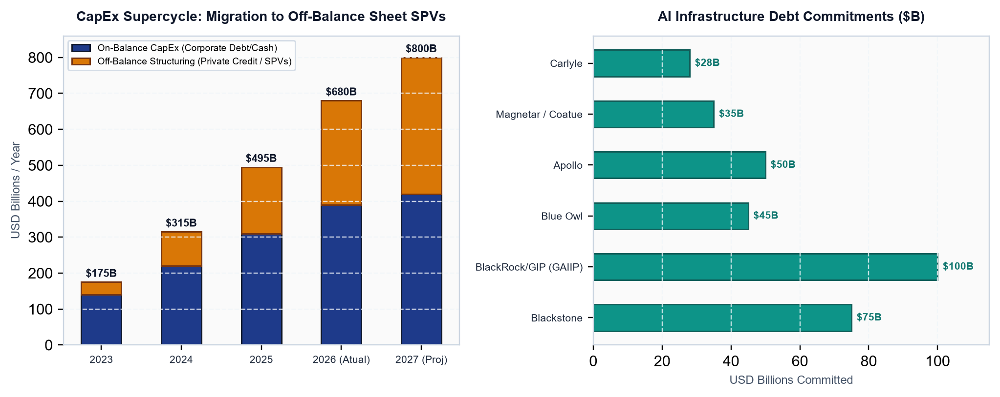
  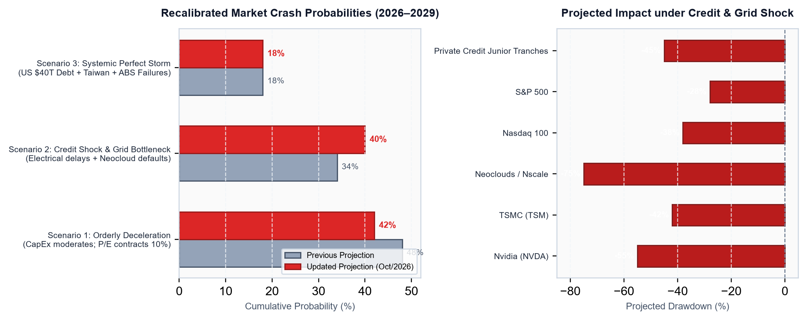
  <br>
  <em>Figure 3: Hyperscaler $700B CapEx run-rate funded by private credit vs. recalibrated stress probabilities across 2026–2029.</em>
</p>

---

## 3. Core Forensic Pillars

```
+-----------------------------------------------------------------------------------+
|                        THE AI CAPITAL RECYCLING MACHINE                           |
+-----------------------------------------------------------------------------------+
|   [Mega-Cap Tech / Chip Designers]                                                |
|             |                                                                     |
|             v (Equity Investments & Convertible Debt)                             |
|   [Neocloud Operators & Frontier Labs (CoreWeave, Lambda Labs, OpenAI, Anthropic)] |
|             |                                                                     |
|             v (Debt-Funded GPU Purchases: H100 / Blackwell B200)                  |
|   [SPVs & Collateralized Hardware Pools] <----+ (Private Credit: Blackstone,      |
|             |                                 |  Blue Owl, Magnetar, Carlyle)     |
|             v (Lease Revenues & Off-Balance PPA)                                  |
|   [Data Center ABS Vehicles (KBRA Rated A / BBB)]                                 |
|             |                                                                     |
|             v (Tranche Distribution to Institutional Pension Funds & Fixed Income)|
|   [Institutional Capital Markets (AAA Senior Notes)]                              |
+-----------------------------------------------------------------------------------+
```

### Pillar A: Vendor Financing & Revenue Loops
- **Mechanism**: Major semiconductor manufacturers invest capital into private startups and cloud providers. The recipients immediately re-route these funds back to the vendor in the form of guaranteed GPU purchase orders.
- **Systemic Risk**: Upwards of 20% to 35% of reported hardware revenue across key suppliers reflects balance-sheet recycling rather than organic corporate end-user demand.

<p align="center">
  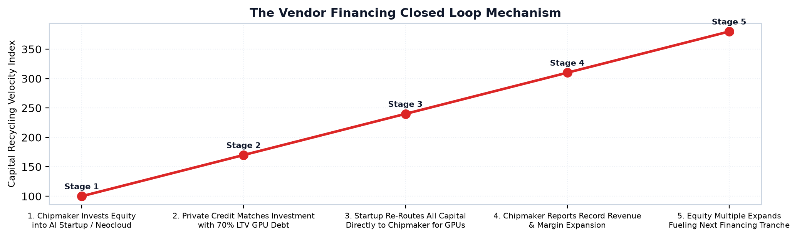
  <br>
  <em>Figure 4: The closed-loop vendor financing dynamic between hardware providers, neoclouds, and hyper-scalers.</em>
</p>

### Pillar B: GPU Collateral Mismatch & Collateral Run
- **Useful Economic Life vs. Amortization**: Enterprise GPUs suffer drastic economic depreciation upon the release of subsequent architectures (e.g., Hopper H100 pricing compression following Blackwell B200 deployment).
- **Negative Equity Dynamic**: Loans structured with 70–80% Loan-to-Value (LTV) ratios on hardware enter technical default when secondary market GPU rental prices drop below $1.50/GPU-hour, breaching debt service coverage covenants ($DSCR < 1.10x$).

<p align="center">
  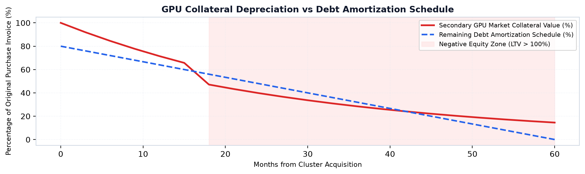
  <br>
  <em>Figure 5: Divergence between physical/economic GPU depreciation curves and amortizing debt schedules.</em>
</p>

### Pillar C: Data Center ABS & The "Subprime AI" Alchemy
- **Securitization Structure**: Powered shell and turnkey data centers are segregated into bankruptcy-remote SPVs. Cash flows from Master Service Agreements (MSAs) and triple-net leases back multi-tranche Asset-Backed Securities (ABS).
- **Subprime Parallel**: Similar to pre-2008 residential mortgage-backed securities (RMBS), correlation risks between unrated tech counterparties and high concentration risks (>60% of revenues tied to single unrated AI startups) are diluted through credit enhancement to achieve investment-grade ratings for senior debt.

<p align="center">
  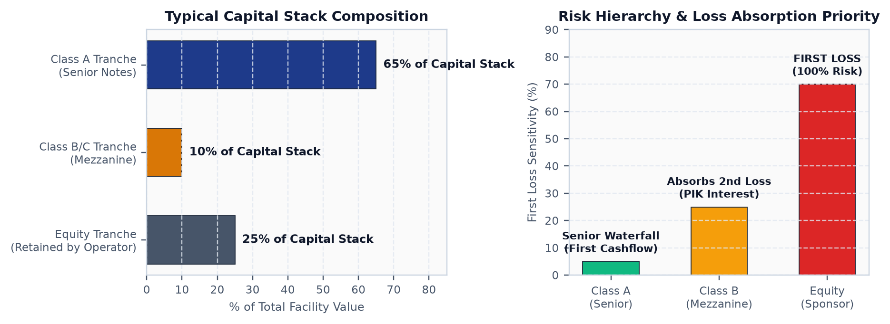
  <br>
  <em>Figure 6: Data Center ABS Capital Structure (Senior Class A Notes, Subordinated Class B, and Residual Equity).</em>
</p>

### Pillar D: Global Macro & Geopolitical Transmission
- **Fiscal Pressures**: Rising US Treasury yields and sovereign debt refinancing friction increase the cost of capital for CapEx-intensive tech infrastructure.
- **Geopolitical Bottlenecks**: High geographic concentration in advanced packaging (TSMC CoWoS, Taiwan) creates severe tail-risk vulnerabilities to supply interruptions.

<p align="center">
  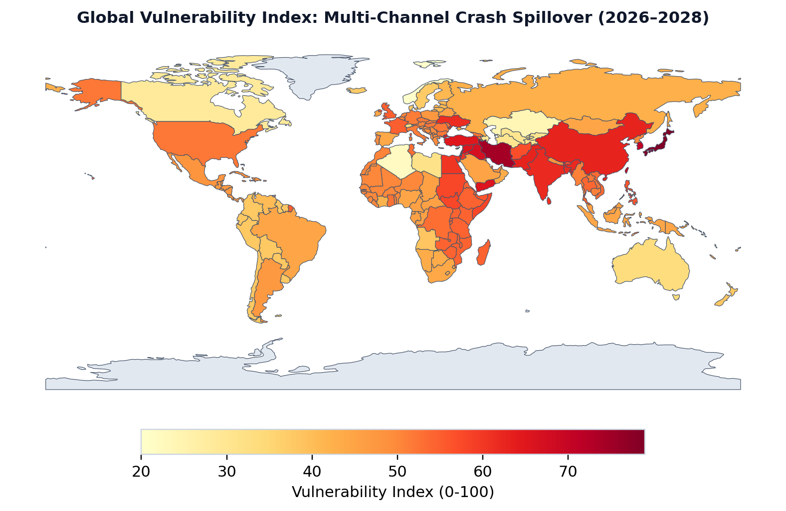
  <br>
  <em>Figure 7: Systemic Vulnerability Index across global financial and technological epicenters (2026–2028).</em>
</p>

---

## 4. Crash Scenarios (2026–2029) & Recalibrated Probability Buildup

Our multi-factor stress models project cumulative systemic stress across three primary scenarios:

| Scenario | Horizon | Cumulative Probability | Catalyst | S&P 500 / Tech Impact | Credit Market Impact |
|:---|:---:|:---:|:---|:---:|:---|
| **Base Case: Orderly Deflation (S1)** | 2026–2027 | **40%** | CapEx growth decelerates to ~10%; enterprise ROI delays; multiple compression. | S&P -15% to -20%<br>Nasdaq -25% | Spreads widen +150 bps; minimal senior ABS impairments. |
| **Severe Case: Credit Dislocation (S2)** | 2027–2028 | **45%** | Neocloud default wave; GPU secondary resale collapse; private credit liquidity freeze. | S&P -30% to -40%<br>Nasdaq -45% | High-yield spreads >750 bps; junior ABS wipeout; banking write-downs. |
| **Systemic Case: Multi-Contagion (S3)** | 2027–2029 | **30%** | Geopolitical supply shock (Taiwan Strait) + US sovereign debt auction friction + AI revenue cliff. | S&P -50% to -60%<br>Nasdaq -65% | Global liquidity freeze; sovereign yield spike; emergency Fed interventions. |

<p align="center">
  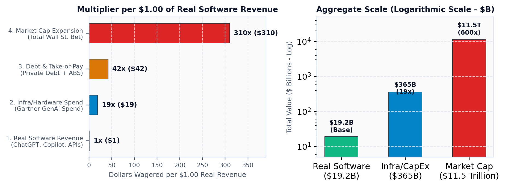
  <br>
  <em>Figure 8: The AI Credit Leverage Pyramid — From physical silicon assets to synthetic credit derivatives.</em>
</p>

---

## 5. Repository Architecture

```text
ai-market-crash-risk/
├── README.md                                   # Master bilingual project documentation
├── LICENSE                                     # GNU General Public License v3.0 (GPL-3.0)
├── .gitignore                                  # Git exclusion rules
│
├── data/                                       # Automated market intelligence datasets (CSV)
│   ├── latest_market_metrics.csv               # Unified master asset & macro dataset
│   ├── companies_valuation_metrics.csv         # Detailed equities valuation & 2-year history
│   ├── macro_financial_condition.csv           # Treasury yields, dollar, debt & macro metrics
│   ├── investment_flows_credit.csv             # Thematic ETFs & corporate credit spreads
│   ├── snapshots/                              # Historical timestamped snapshot archive
│   └── ai_agent_research_brief.md              # Research protocol & queries for AI Agent
│
├── reports/                                    # Executive PDF Reports (ReportLab Platypus)
│   ├── en/                                     # 8 English Institutional PDFs (51 pages)
│   └── pt/                                     # 8 Portuguese Institutional PDFs (51 pages)
│
├── docs/                                       # In-depth Analytical Markdown Dossiers
│   ├── en/                                     # 10 English technical research dossiers
│   └── pt/                                     # 10 Portuguese technical research dossiers
│
├── scripts/                                    # Python orchestration & generation scripts
│   ├── fetch_market_pipeline.py                # Automated data ingestion & valuation pipeline
│   ├── build_all_reports.py                    # Master pipeline runner
│   ├── generate_charts_en.py                   # Dedicated English charts compiler
│   ├── generate_company_charts.py              # Bilingual company forecast charts
│   ├── generate_recent_market_update_charts.py # Grid bottlenecks & Anthropic valuation charts
│   ├── generate_page_previews.py               # High-res PDF page preview generator (102 images)
│   ├── utils_paths.py                          # Path resolution utility
│   ├── generate_recent_market_update_report.py # October 2026 special update report
│   └── ...                                     # 14 other modular report generators
│
├── assets/
│   ├── charts/                                 # 80 Bilingual financial & risk charts
│   │   ├── en/                                 # 40 English charts (chart_*.png)
│   │   └── pt/                                 # 40 Portuguese charts (chart_*.png)
│   ├── previews/                               # 102 High-resolution report page previews
│   │   ├── en/                                 # 51 English report page preview PNGs
│   │   └── pt/                                 # 51 Portuguese report page preview PNGs
│   └── geo/                                    # world_countries_110m.geojson spatial database
│
└── .agents/skills/
    └── ai-market-risk-updater/                 # Workspace Skill for model updating
        ├── SKILL.md                            # Comprehensive update runbook & instructions
        ├── references/                         # Sources, APIs, mathematical models & workflow
        └── scripts/validate_models.py          # Automated verification test suite
```

---

## 6. Deliverables Index: Reports & Dossiers

All executive reports are available in full institutional-grade PDF format (102 pages compiled) and detailed technical Markdown dossiers:

### 📑 Executive PDF Reports (Institutional Format)

| Document Title | Language | Pages | Download / Access | Page Previews |
|:---|:---:|:---:|:---:|:---:|
| **Market Update: Grid Choke Point & Anthropic Haircut (2026–2029)** | 🇺🇸 English | 8 | [Download PDF](reports/en/Report_Market_Update_Oct2026_Grid_Anthropic.pdf) | [View Previews](assets/previews/en/) |
| **Atualização: Gargalo da Rede Elétrica e Desconto Anthropic (2026–2029)** | 🇧🇷 Português | 8 | [Download PDF](reports/pt/Relatorio_Atualizacao_Mercado_Outubro_2026_Nscale_Anthropic_Grid.pdf) | [Ver Prévias](assets/previews/pt/) |
| **Macro Geopolitical Market Crash (2026–2028)** | 🇺🇸 English | 10 | [Download PDF](reports/en/Report_Macro_Geopolitics_Market_Crash_2026_2028.pdf) | [View Previews](assets/previews/en/) |
| **Macro Geopolítica Quebra de Mercado (2026–2028)** | 🇧🇷 Português | 10 | [Download PDF](reports/pt/Relatorio_Macro_Geopolitica_Quebra_Mercado_2026_2028.pdf) | [Ver Prévias](assets/previews/pt/) |
| **US Financial Market & AI Bubble Architecture** | 🇺🇸 English | 8 | [Download PDF](reports/en/Report_US_Financial_Market_AI_Bubble.pdf) | [View Previews](assets/previews/en/) |
| **Mercado Financeiro Americano e Bolha de IA** | 🇧🇷 Português | 8 | [Download PDF](reports/pt/Relatorio_Mercado_Financeiro_Americano.pdf) | [Ver Prévias](assets/previews/pt/) |
| **Company Financial Status, Stocks & 2027 Forecasts** | 🇺🇸 English | 8 | [Download PDF](reports/en/Report_AI_Leaders_Financial_Status_2027_Forecasts.pdf) | [View Previews](assets/previews/en/) |
| **Status Financeiro, Ações e Previsões (2027)** | 🇧🇷 Português | 8 | [Download PDF](reports/pt/Relatorio_Status_Financeiro_Acoes_Previsao_Empresas_IA.pdf) | [Ver Prévias](assets/previews/pt/) |
| **AI Infrastructure Crash Scenarios (2026–2029)** | 🇺🇸 English | 5 | [Download PDF](reports/en/Report_AI_Market_Crash_Scenarios_2026_2029.pdf) | [View Previews](assets/previews/en/) |
| **Cenários de Quebra do Mercado de IA (2026–2029)** | 🇧🇷 Português | 5 | [Download PDF](reports/pt/Relatorio_Cenarios_Quebra_Mercado_IA_2026_2029.pdf) | [Ver Prévias](assets/previews/pt/) |
| **Data Center ABS Official Tranches & KBRA** | 🇺🇸 English | 4 | [Download PDF](reports/en/Report_Data_Center_ABS_Official_Tranches.pdf) | [View Previews](assets/previews/en/) |
| **Data Center ABS Tranches Oficiais e KBRA** | 🇧🇷 Português | 4 | [Download PDF](reports/pt/Relatorio_Data_Center_ABS_Tranches_Oficiais.pdf) | [Ver Prévias](assets/previews/pt/) |
| **Forensic AI Subprime & AAA Repackaging** | 🇺🇸 English | 4 | [Download PDF](reports/en/Report_Forensic_AI_Subprime_AAA_Repackaging.pdf) | [View Previews](assets/previews/en/) |
| **Dossiê Forense Subprime de IA e Repacotamento AAA**| 🇧🇷 Português | 4 | [Download PDF](reports/pt/Relatorio_Forense_Subprime_IA_Repacotamento_AAA.pdf) | [Ver Prévias](assets/previews/pt/) |
| **Leverage Multiplier & Vendor Financing** | 🇺🇸 English | 4 | [Download PDF](reports/en/Report_AI_Leverage_and_Vendor_Financing.pdf) | [View Previews](assets/previews/en/) |
| **Alavancagem e Vendor Financing de IA** | 🇧🇷 Português | 4 | [Download PDF](reports/pt/Relatorio_Alavancagem_e_Vendor_Financing_IA.pdf) | [Ver Prévias](assets/previews/pt/) |

---

### 📂 Technical Markdown Dossiers

| Technical Dossier (English) | Dossier Técnico (Português) | Primary Research Subject |
|:---|:---|:---|
| [Market Update: Grid & Anthropic](docs/en/Dossie_Market_Update_October_2026_Nscale_Anthropic_Grid_EN.md) | [Dossiê Atualização: Grid & Anthropic](docs/pt/Dossie_Atualizacao_Mercado_Outubro_2026_Nscale_Anthropic_Grid.md) | Microsoft-Nscale Essex cancellation, Anthropic $1.5T valuation cut, utility queue freezes & recalibrated risk matrix. |
| [October 2026 News Intelligence Sources](docs/en/Recent_News_Sources_October_2026.md) | [Fontes e Notícias Recentes Outubro 2026](docs/pt/Fontes_Noticias_Recentes_Outubro_2026.md) | Verified audit trail of press reports (FT, Euronext, Business Insider), SEC filings, National Grid UK notices. |
| [AI Leaders Financial Audit & 2027 Forecasts](docs/en/Dossie_Status_Financeiro_Acoes_Previsao_Empresas_IA_EN.md) | [Dossiê Status Financeiro das Líderes e Previsões](docs/pt/Dossie_Status_Financeiro_Acoes_Previsao_Empresas_IA.md) | Corporate balance sheets, 2-year returns & semiannual predictive target price matrix. |
| [Macro Geopolitics & Market Crash Dossier](docs/en/Dossie_Macro_Geopolitica_Quebra_Mercado_2026_2028_EN.md) | [Dossiê Macro Geopolítica e Quebra de Mercado](docs/pt/Dossie_Macro_Geopolitica_Quebra_Mercado_2026_2028.md) | US fiscal debt, Taiwan Strait, oil choke points & regional ranking. |
| [AI Market Crash Scenarios (2026–2029)](docs/en/Dossie_Cenarios_Quebra_Mercado_Acoes_e_Credito_EN.md) | [Dossiê Cenários de Quebra de Mercado](docs/pt/Dossie_Cenarios_Quebra_Mercado_Acoes_e_Credito.md) | Multi-year cascade simulation, loss severity and recovery rates. |
| [Data Center ABS Structuring Report](docs/en/Data_Center_ABS_Relatorio_EN.md) | [Relatório Data Center ABS](docs/pt/Data_Center_ABS_Relatorio.md) | Master Service Agreements, PPA contracts and SPV waterfalls. |
| [Forensic Subprime AI & AAA Alchemy](docs/en/Dossie_Forense_Subprime_IA_Repacotamento_AAA_EN.md) | [Dossiê Forense Subprime IA Repacotamento](docs/pt/Dossie_Forense_Subprime_IA_Repacotamento_AAA.md) | Synthetic securitization, rating arbitrage, CDO parallels. |
| [AI Credit Leverage & Vendor Financing](docs/en/Dossie_Alavancagem_Vendor_Financing_IA_EN.md) | [Dossiê Alavancagem e Vendor Financing](docs/pt/Dossie_Alavancagem_Vendor_Financing_IA.md) | Circularity loops between chipmakers, hyper-scalers and neoclouds. |
| [CoreWeave GPU Debt & Financing Analysis](docs/en/CoreWeave_GPU_Debt_and_Vendor_Financing_Analysis_EN.md) | [Análise da Dívida GPU CoreWeave](docs/pt/CoreWeave_GPU_Debt_and_Vendor_Financing_Analysis.md) | Balance-sheet forensic audit, GPU depreciation vs debt covenants. |
| [KBRA Data Center ABS Rating Methodology](docs/en/KBRA_Data_Center_ABS_Rating_Methodology_Dossier_EN.md) | [Metodologia de Rating KBRA Data Center](docs/pt/KBRA_Data_Center_ABS_Rating_Methodology_Dossier.md) | Formal credit rating agency methodologies and liquidity reserves. |

---

## 7. Automated Data Pipeline & Updating via Antigravity Skills

The repository includes a dedicated Antigravity Workspace Skill located at:
`[.agents/skills/ai-market-risk-updater/](.agents/skills/ai-market-risk-updater/)`

To perform a fast, fully automated data refresh:
```bash
# Step 1: Run quantitative market pipeline to refresh data/ CSVs
py scripts/fetch_market_pipeline.py

# Step 2: Prompt the AI Agent to review data/ai_agent_research_brief.md, conduct web news research, and rebuild reports:
py scripts/build_all_reports.py
```

The skill automatically loads:
1. **[Data Sources & Official Feeds](.agents/skills/ai-market-risk-updater/references/sources_and_apis.md)**: FRED, TreasuryDirect, SEC EDGAR, KBRA, TSMC.
2. **[Quantitative Methodologies](.agents/skills/ai-market-risk-updater/references/quantitative_methodologies.md)**: GPU hyper-depreciation formulas, DSCR covenant limits, Geopolitical Vulnerability Index.
3. **[Update Workflow](.agents/skills/ai-market-risk-updater/references/update_workflow.md)**: Step-by-step parameter modifications and compilation instructions.
4. **Validation Test**: Automatic sanity check via `validate_models.py`.

---

## 8. Technical Reproduction & Execution

```bash
# Clone the repository
git clone https://github.com/xToshiro/ai-market-crash-risk.git
cd ai-market-crash-risk

# Install required dependencies
pip install reportlab matplotlib numpy pandas geopandas shapely pymupdf

# Reproduce all 36 charts (EN & PT), compile all 14 PDF reports (86 pages), and generate 86 page previews:
python scripts/build_all_reports.py

# Validate full repository integrity:
python .agents/skills/ai-market-risk-updater/scripts/validate_models.py
```

---
---

# 🇧🇷 Versão em Português

## 1. Visão Geral Executiva

Este repositório reúne uma profunda investigação forense institucional sobre a estrutura de crédito, alavancagem sintética e canais de transmissão macro-geopolítica que sustentam o atual **superciclo de infraestrutura em Inteligência Artificial**.

Entre 2023 e 2026, mais de **US$ 350 bilhões** em despesas de capital (CapEx) foram alocados em infraestrutura de computação acelerada, data centers e chips avançados. Contudo, uma parcela crescente dessa expansão não se traduz em receita recorrente de software no cliente final corporativo, dependendo criticamente de:
1. **Vendor Financing Circular**: Fabricantes de silício injetando capital societário em operadoras de nuvem e startups de IA que, por contrato, reorientam esse caixa para comprar GPUs do próprio fornecedor.
2. **Dívida Lastreada em GPUs e Hiper-Depreciação**: Linhas de crédito privado e mezanino garantidas por ativos de silício (NVIDIA H100/B200) cuja obsolescência técnica (2,5 a 3 anos) é muito mais veloz que o prazo de amortização do passivo (5 a 7 anos).
3. **Data Center ABS e Repacotamento Sintético**: Securitização de contratos de locação de data centers via SPEs (Sociedades de Propósito Específico), fatiadas em tranches seniores com rating AAA/A (por agências como a KBRA) e tranches subordinadas, reproduzindo a mesma dinâmica de incentivos perversos dos subprime RMBS de 2007–2008.
4. **Vulnerabilidade Geopolítica e Abismo Fiscal dos EUA**: A convergência entre o endividamento do Tesouro americano (US$ 36,5 trilhões de dívida soberana, >US$ 1,1 trilhão ao ano em juros), a rotação regulatória do ciclo eleitoral, a repatriação de fundos soberanos do Golfo Pérsico e os gargalos logísticos no Estreito de Taiwan.

<p align="center">
  
  <br>
  <em>Figura 1: Anatomia e canais de transmissão da quebra de mercado projetada (2026–2028).</em>
</p>

---

## 2. Boletim Especial de Inteligência (Outubro de 2026): Novas Descobertas vs. Situação Antiga

A atualização de inteligência de outubro de 2026 incorpora desdobramentos cruciais na interconexão física da rede elétrica, nas avaliações do mercado privado de tecnologia, na aceleração do CapEx dos hiperscalers e na estruturação de crédito sombra. Abaixo está a confrontação forense entre as premissas antigas e as descobertas de hoje:

### 📊 Matriz Comparativa: Premissas Anteriores vs. Realidade de Mercado (Outubro de 2026)

| Pilar de Investigação | Premissa Anterior / Situação Antiga | Descobertas Reais de Hoje (Outubro de 2026) | Impacto Sistêmico e Canal de Transmissão |
|:---|:---|:---|:---|
| **Rede Elétrica e Entrega de Data Centers** | Expansão de energia presumida como ilimitada; data centers projetados para energização rápida em 18 a 24 meses em qualquer geografia. | **O Muro da Rede Elétrica**: Cancelamento emblemático do contrato de data center entre **Microsoft e Nscale em Essex (Reino Unido)** por falta de capacidade na rede de transmissão. Filas de conexão da PJM (EUA) e National Grid (UK) congeladas por **7 a 10 anos (2033–2036)**. | Terrenos adquiridos e GPUs compradas viram **"ativos encalhados" (*stranded assets*)**; infraestrutura inoperante gera zero receita enquanto os juros da dívida continuam correndo. |
| **Valuations dos Laboratórios de IA** | Escala exponencial de receita ARR (>300% ao ano); transações privadas avaliando laboratórios de ponta (Anthropic, OpenAI) em até **US$ 1,5 Trilhão** pré-IPO. | **Desconto de Valuation e Desaceleração**: Valuation privado da Anthropic reajustado com **corte de ~60% para a faixa de US$ 600B–US$ 700B**; crescimento anual desacelerou para **~85% ao ano** diante do custo de inferência e comoditização por modelos abertos. | Redução drástica no valor de garantias societárias; adiamento de liquidez de IPOs; compressão de múltiplos em todas as empresas de software listadas. |
| **CapEx dos Hiperscalers e Alavancagem** | Despesas de capital projetadas em patamar de ~US$ 350B–US$ 400B ao ano, 100% bancadas pelo fluxo de caixa operacional das Big Techs sem risco de crédito. | **Hiper-CapEx de US$ 700B e Dívida Sombra**: Ritmo anual de CapEx atingiu **US$ 700 Bilhões**, cada vez mais dependente de **SPEs fora do balanço e crédito privado** (Blackstone, Ares, Apollo) em vez de caixa puro. | Migração do risco para o setor bancário sombra; índices de cobertura da dívida (ICSD) caem abaixo de $1,10x$ caso as locações sofram atrasos operacionais. |
| **Taxas de Juros Macro e Dívida Soberana** | Expectativa de corte rápido de juros pelo Federal Reserve para ~3,0%; refinanciamento tranquilo de dívidas corporativas de tecnologia. | **Juros Altos por Mais Tempo e Dívida de US$ 36,85T**: Yield dos Treasuries de 10 anos firme em **5,10%**; despesa anual com juros da dívida americana supera **US$ 1,16 Trilhão/ano**; custo de refinanciamento corporativo segue elevado. | Abertura de spreads de crédito corporativo (razão `HYG/LQD` em 0,7433); aumento na taxa de desconto de projetos de infraestrutura de longo prazo. |
| **Probabilidades de Quebra Acumuladas** | Cenário benigno / "pouso suave" estimado em **70%**; contágio sistêmico considerado risco de cauda desprezível (**<15%**). | **Matriz de Risco Recalibrada (2026–2029)**:<br>• **Deflação Ordenada (S1)**: **40%**<br>• **Deslocamento de Crédito (S2)**: **45%**<br>• **Contágio Sistêmico Global (S3)**: **30%**<br>• *Continuação Benigna*: Reduzida a **25%**. | A mecânica do subprime de IA deixa de ser uma vulnerabilidade teórica e passa a apresentar gatilhos empíricos de inadimplência. |

<p align="center">
  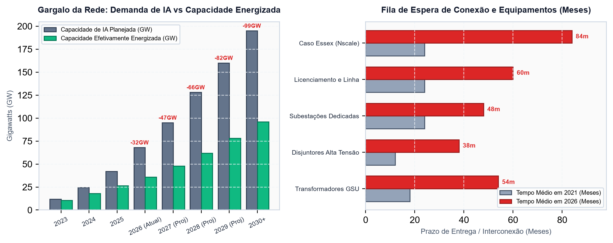
  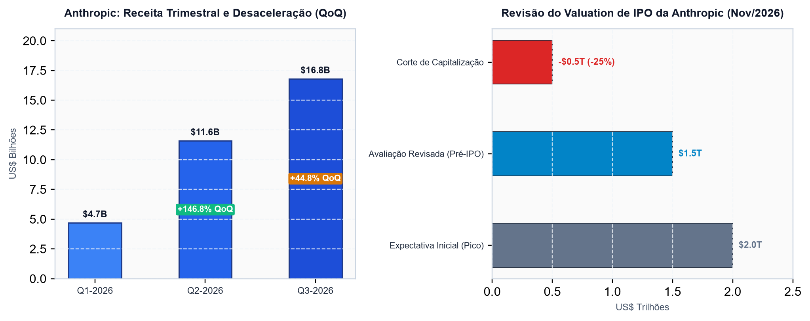
  <br>
  <em>Figura 2: Filas de interconexão na rede elétrica vs. desaceleração de receita pré-IPO e compressão de valuations.</em>
</p>

<p align="center">
  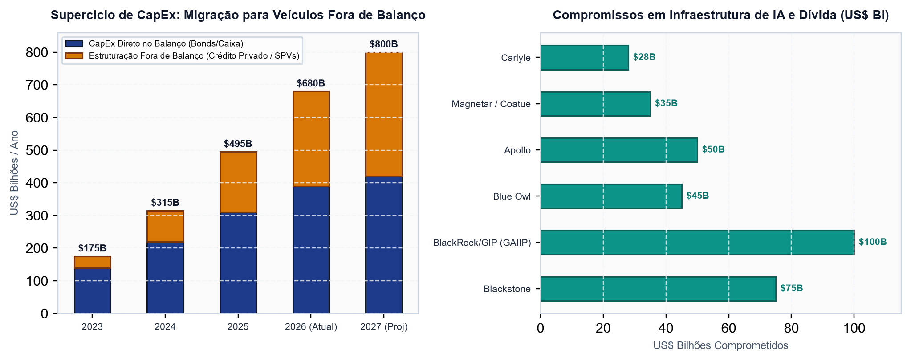
  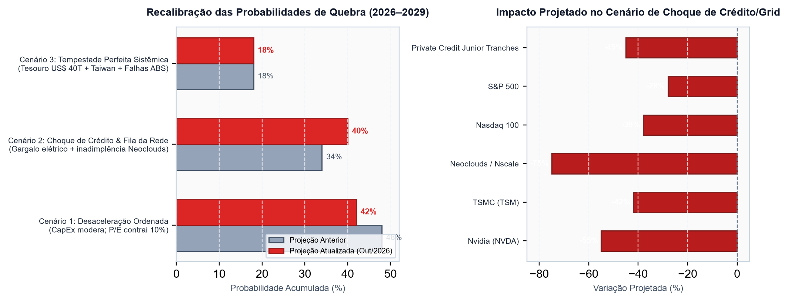
  <br>
  <em>Figura 3: Ritmo de CapEx de US$ 700B financiado por crédito privado vs. probabilidades estressadas de quebra (2026–2029).</em>
</p>

---

## 3. Pilares Forenses da Investigação

### Pilar 1: O Loop de Financiamento de Vendedores (Vendor Financing)
Fabricantes líderes de tecnologia fornecem capital de investimento a startups de nuvem especializada (*neoclouds*) e laboratórios de IA. Os recursos recebidos são obrigatoriamente revertidos em aquisições de chips de ponta do próprio investidor. Essa circularidade infla artificialmente o faturamento de curto prazo e adia a descoberta de demanda real do mercado.

<p align="center">
  
  <br>
  <em>Figura 4: O ciclo fechado de vendor financing entre provedores de hardware, neoclouds e hiperscalers.</em>
</p>

### Pilar 2: Descasamento de Depreciação de Hardware e Dívida
Uma GPU de data center tem vida útil econômica de ponta restrita a 2 ou 3 anos antes do lançamento de clusters mais eficientes. Quando operadoras contraem dívida de 5 a 7 anos para amortizar esse equipamento, o valor de revenda e o preço de aluguel por hora caem abruptamente, quebrando o índice de cobertura de serviço da dívida ($ICSD < 1,10x$) e forçando liquidações de garantias.

<p align="center">
  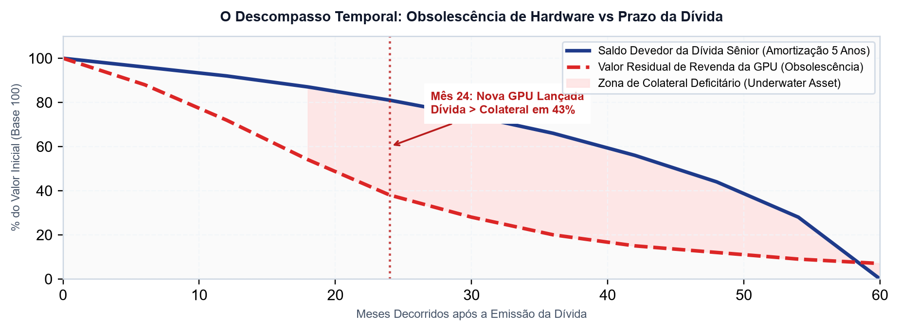
  <br>
  <em>Figura 5: Divergência entre curvas de depreciação física/econômica de GPUs e cronogramas de amortização de dívida.</em>
</p>

### Pilar 3: O "Subprime de IA" e o Repacotamento AAA
Data centers são empacotados em estruturas de securitização (Data Center ABS). Por meio de reforços de crédito estruturais (*credit enhancement*), operadoras transformam fluxos de recebíveis dependentes de startups de IA deficitárias em títulos seniores de investimento comercializados a fundos de pensão institucionais.

<p align="center">
  
  <br>
  <em>Figura 6: Estrutura de capital de Data Center ABS (Notas Classe A Sênior, Classe B Mezanino e Equity Residual).</em>
</p>

### Pilar 4: Transmissão Geopolítica e Risco Soberano
O custo do capital global subiu estruturalmente. Com as taxas de juros americanas elevadas e emissões recordes do Tesouro dos EUA, a absorção de centenas de bilhões de dólares em crédito privado para data centers disputa liquidez diretamente com títulos soberanos e fundos imobiliários tradicionais.

<p align="center">
  
  <br>
  <em>Figura 7: Índice de Vulnerabilidade Sistêmica nos epicentros financeiros e tecnológicos mundiais (2026–2028).</em>
</p>

<p align="center">
  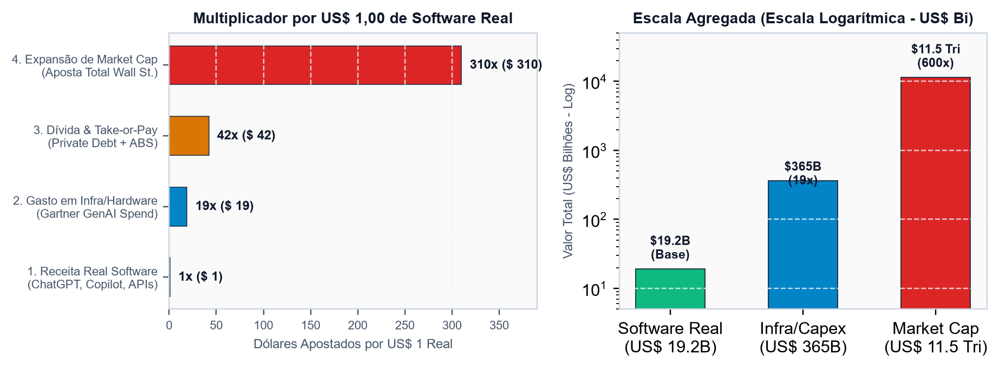
  <br>
  <em>Figura 8: A Pirâmide de Alavancagem do Crédito de IA — Dos ativos físicos de silício aos derivativos sintéticos.</em>
</p>

---

## 4. Matriz de Cenários de Quebra (2026–2029) Recalibrada

| Cenário | Janela | Probabilidade Acumulada | Gatilho Primário | Impacto no Mercado de Ações | Mercado de Crédito Privado |
|:---|:---:|:---:|:---|:---:|:---|
| **Base: Desinflação Ordenada (S1)** | 2026–2027 | **40%** | Crescimento do CapEx desacelera; maturação e corte de múltiplos de avaliação. | S&P 500: -15% a -20%<br>Nasdaq: -25% | Spreads abrem +150 bps; perdas absorvidas pelas tranches de equity. |
| **Severo: Deslocamento de Crédito (S2)** | 2027–2028 | **45%** | Onda de inadimplência em neoclouds; derrocada no mercado secundário de GPUs. | S&P 500: -30% a -40%<br>Nasdaq: -45% | Spreads de High Yield >750 bps; colapso de tranches subordinadas de ABS. |
| **Sistêmico: Multi-Contágio Global (S3)** | 2027–2029 | **30%** | Choque logístico em semicondutores (Taiwan) + crise de liquidez na dívida soberana dos EUA. | S&P 500: -50% a -60%<br>Nasdaq: -65% | Congelamento de liquidez bancária; intervenção emergencial do Federal Reserve. |

---

## 5. Índice de Entregáveis: Relatórios Executivos e Dossiês

Todos os relatórios executivos estão disponíveis em formato PDF institucional (102 páginas compiladas) e dossiês técnicos em Markdown:

### 📑 Relatórios Executivos em PDF (Formato Institucional)

| Título do Documento | Idioma | Páginas | Download / Acesso | Prévias em Imagem |
|:---|:---:|:---:|:---:|:---:|
| **Atualização: Gargalo da Rede Elétrica e Desconto Anthropic (2026–2029)** | 🇧🇷 Português | 8 | [Baixar PDF](reports/pt/Relatorio_Atualizacao_Mercado_Outubro_2026_Nscale_Anthropic_Grid.pdf) | [Ver Prévias](assets/previews/pt/) |
| **Market Update: Grid Choke Point & Anthropic Haircut (2026–2029)** | 🇺🇸 English | 8 | [Download PDF](reports/en/Report_Market_Update_Oct2026_Grid_Anthropic.pdf) | [View Previews](assets/previews/en/) |
| **Macro Geopolítica Quebra de Mercado (2026–2028)** | 🇧🇷 Português | 10 | [Baixar PDF](reports/pt/Relatorio_Macro_Geopolitica_Quebra_Mercado_2026_2028.pdf) | [Ver Prévias](assets/previews/pt/) |
| **Mercado Financeiro Americano e Bolha de IA** | 🇧🇷 Português | 8 | [Baixar PDF](reports/pt/Relatorio_Mercado_Financeiro_Americano.pdf) | [Ver Prévias](assets/previews/pt/) |
| **Status Financeiro, Ações e Previsões (2027)** | 🇧🇷 Português | 8 | [Baixar PDF](reports/pt/Relatorio_Status_Financeiro_Acoes_Previsao_Empresas_IA.pdf) | [Ver Prévias](assets/previews/pt/) |
| **Cenários de Quebra do Mercado de IA (2026–2029)** | 🇧🇷 Português | 5 | [Baixar PDF](reports/pt/Relatorio_Cenarios_Quebra_Mercado_IA_2026_2029.pdf) | [Ver Prévias](assets/previews/pt/) |
| **Data Center ABS Tranches Oficiais e KBRA** | 🇧🇷 Português | 4 | [Baixar PDF](reports/pt/Relatorio_Data_Center_ABS_Tranches_Oficiais.pdf) | [Ver Prévias](assets/previews/pt/) |
| **Dossiê Forense Subprime de IA e Repacotamento AAA**| 🇧🇷 Português | 4 | [Baixar PDF](reports/pt/Relatorio_Forense_Subprime_IA_Repacotamento_AAA.pdf) | [Ver Prévias](assets/previews/pt/) |
| **Alavancagem e Vendor Financing de IA** | 🇧🇷 Português | 4 | [Baixar PDF](reports/pt/Relatorio_Alavancagem_e_Vendor_Financing_IA.pdf) | [Ver Prévias](assets/previews/pt/) |

---

### 📂 Dossiês Técnicos em Markdown

| Dossiê Técnico (Português) | Technical Dossier (English) | Tema Central de Pesquisa |
|:---|:---|:---|
| [Dossiê Atualização: Grid & Anthropic](docs/pt/Dossie_Atualizacao_Mercado_Outubro_2026_Nscale_Anthropic_Grid.md) | [Market Update: Grid & Anthropic](docs/en/Dossie_Market_Update_October_2026_Nscale_Anthropic_Grid_EN.md) | Cancelamento Essex da Microsoft-Nscale, corte de valuation de $1,5T da Anthropic e gargalo elétrico. |
| [Fontes e Notícias Recentes Outubro 2026](docs/pt/Fontes_Noticias_Recentes_Outubro_2026.md) | [October 2026 News Intelligence Sources](docs/en/Recent_News_Sources_October_2026.md) | Pistas de auditoria da cobertura de imprensa (FT, Euronext, Business Insider), filings SEC e National Grid UK. |
| [Dossiê Status Financeiro das Líderes e Previsões](docs/pt/Dossie_Status_Financeiro_Acoes_Previsao_Empresas_IA.md) | [AI Leaders Financial Audit & 2027 Forecasts](docs/en/Dossie_Status_Financeiro_Acoes_Previsao_Empresas_IA_EN.md) | Balanços corporativos, retornos de 2 anos e matriz preditiva de preços semestrais. |
| [Dossiê Macro Geopolítica e Quebra de Mercado](docs/pt/Dossie_Macro_Geopolitica_Quebra_Mercado_2026_2028.md) | [Macro Geopolitics & Market Crash Dossier](docs/en/Dossie_Macro_Geopolitica_Quebra_Mercado_2026_2028_EN.md) | Dívida fiscal dos EUA, Estreito de Taiwan, gargalos de petróleo e ranking regional de vulnerabilidade. |
| [Dossiê Cenários de Quebra de Mercado](docs/pt/Dossie_Cenarios_Quebra_Mercado_Acoes_e_Credito.md) | [AI Market Crash Scenarios (2026–2029)](docs/en/Dossie_Cenarios_Quebra_Mercado_Acoes_e_Credito_EN.md) | Simulação estocástica em cascata, severidade de perda e taxas de recuperação. |
| [Relatório Data Center ABS](docs/pt/Data_Center_ABS_Relatorio.md) | [Data Center ABS Structuring Report](docs/en/Data_Center_ABS_Relatorio_EN.md) | Contratos de locação triplo-neto, contratos de energia PPA e cascata de pagamentos de SPVs. |
| [Dossiê Forense Subprime IA Repacotamento](docs/pt/Dossie_Forense_Subprime_IA_Repacotamento_AAA.md) | [Forensic Subprime AI & AAA Alchemy](docs/en/Dossie_Forense_Subprime_IA_Repacotamento_AAA_EN.md) | Securitização sintética, arbitragem de rating e paralelos com a crise dos CDOs de 2008. |
| [Dossiê Alavancagem e Vendor Financing](docs/pt/Dossie_Alavancagem_Vendor_Financing_IA.md) | [AI Credit Leverage & Vendor Financing](docs/en/Dossie_Alavancagem_Vendor_Financing_IA_EN.md) | Ciclos de circularidade de capital entre fabricantes de chips, hiperscalers e neoclouds. |
| [Análise da Dívida GPU CoreWeave](docs/pt/CoreWeave_GPU_Debt_and_Vendor_Financing_Analysis.md) | [CoreWeave GPU Debt & Financing Analysis](docs/en/CoreWeave_GPU_Debt_and_Vendor_Financing_Analysis_EN.md) | Auditoria forense de balanço patrimonial, depreciação acelerada de GPUs vs covenants de dívida. |
| [Metodologia de Rating KBRA Data Center](docs/pt/KBRA_Data_Center_ABS_Rating_Methodology_Dossier.md) | [KBRA Data Center ABS Rating Methodology](docs/en/KBRA_Data_Center_ABS_Rating_Methodology_Dossier_EN.md) | Critérios oficiais de agências de rating de crédito e reservas de liquidez estrutural. |

---

## 5. Pipeline Automatizado de Dados e Atualização Futura

Para atualizar o observatório de mercado no futuro de forma rápida, reprodutível e orientada a dados, o repositório disponibiliza um pipeline numérico em Python integrado à skill do Antigravity:

### 🚀 Executando o Pipeline de Coleta de Mercado (Numérico)
Execute o script em linha de comando única:
```bash
py scripts/fetch_market_pipeline.py
```

O pipeline consulta 45+ ativos financeiros em tempo real e consolida múltiplos arquivos CSV estruturados na pasta [`data/`](data/):
- **[`data/latest_market_metrics.csv`](data/latest_market_metrics.csv)**: Dataset consolidado mestre com todas as classes de ativos, preços, variações (1D, 1M, 6M, 1Y, 2Y) e múltiplos de avaliação.
- **[`data/companies_valuation_metrics.csv`](data/companies_valuation_metrics.csv)**: Ações líderes de IA (NVDA, MSFT, GOOGL, META, AAPL, TSM, ASML, AVGO), infraestrutura elétrica (VST, CEG, NEE, TLN), neoclouds (PLTR, CRWD) e crédito privado (BX, ARES, APO, BIZD).
- **[`data/macro_financial_condition.csv`](data/macro_financial_condition.csv)**: Curva de Treasuries (10Y, 30Y, 13W), Dólar (DXY), Ouro, Petróleo WTI, VIX e baseline da dívida soberana dos EUA ($36,8T+).
- **[`data/investment_flows_credit.csv`](data/investment_flows_credit.csv)**: Fluxos de ETFs temáticos (QQQ, SMH, XLU, PAVE) e apetite a risco de crédito corporativo (proporção `HYG / LQD`).
- **[`data/ai_agent_research_brief.md`](data/ai_agent_research_brief.md)**: Dossiê analítico gerado dinamicamente para orientar o agente de IA com anomalias estatísticas e queries de pesquisa direcionadas.

### 🤖 Protocolo para o Agente de IA (Síntese Numérica + Pesquisa Web)
Ao solicitar uma nova atualização de relatório:
1. O agente executa `py scripts/fetch_market_pipeline.py` para renovar todos os dados numéricos em CSV.
2. O agente lê [`data/ai_agent_research_brief.md`](data/ai_agent_research_brief.md) e [`data/latest_market_metrics.csv`](data/latest_market_metrics.csv).
3. O agente executa buscas na internet em sites institucionais confiáveis (*Financial Times, Bloomberg, Reuters, SEC EDGAR, KBRA, EIA, operadoras de rede PJM/National Grid*) para identificar os catalisadores qualitativos das mudanças observadas.
4. O agente calibra os dicionários de premissas (`FACTS`, `SCENARIOS`, `TRANCHES`) e roda `py scripts/build_all_reports.py` para gerar os novos relatórios PDF e dossiês.

---

## 7. Licença e Aviso Legal (Disclaimer)

**Licença**: Este projeto é disponibilizado sob a licença **GNU General Public License v3.0 (GPL-3.0)**. Consulte o arquivo [LICENSE](LICENSE) para termos integrais.

**Aviso Legal / Financial Disclaimer**:
*Este repositório destina-se exclusivamente a fins de pesquisa acadêmica, forense e de inteligência de mercado financeiro. Os modelos, projeções, probabilidades e cenários de estresse aqui apresentados representam simulações analíticas de risco de cauda e não configuram recomendação de investimento, aconselhamento financeiro, solicitação de compra/venda de ativos ou garantia de desempenho futuro.*
